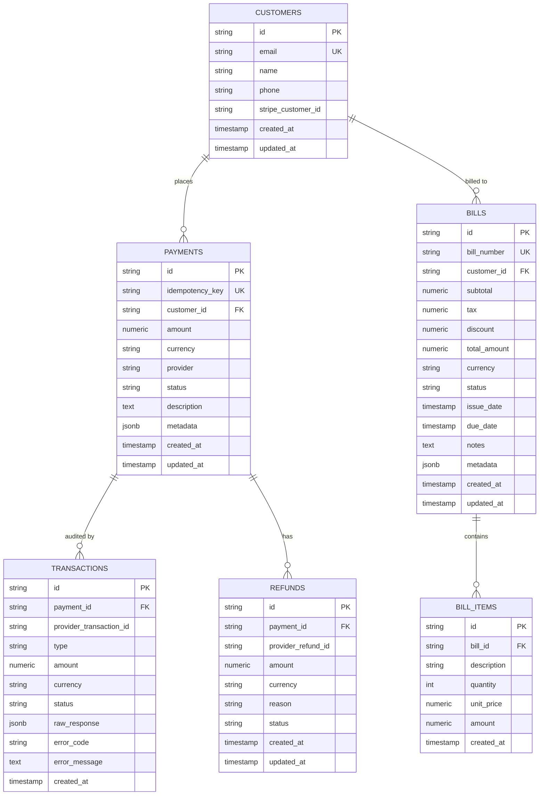

# LedgerFlow Payment & Billing Service

[](https://golang.org)
[](https://gin-gonic.com/)
[](https://www.postgresql.org/)
[](http://localhost:8081/swagger/index.html)
[](LICENSE)

**LedgerFlow Payment & Billing Service** is an enterprise-grade, high-performance microservice written in Go. It delivers a unified multi-tenant payment gateway abstraction, robust transaction ledger tracking, automated billing/invoicing, and cloud-native observability.

---

## Table of Contents

- [Overview](#overview)
- [Architecture & Design](#architecture--design)
- [Core Features](#core-features)
- [Supported Payment Gateways](#supported-payment-gateways)
- [Project Directory Structure](#project-directory-structure)
- [Database Schema & Migrations](#database-schema--migrations)
- [Configuration & Environment Variables](#configuration--environment-variables)
- [Getting Started](#getting-started)
  - [Prerequisites](#prerequisites)
  - [Installation & Setup](#installation--setup)
  - [Running the Service](#running-the-service)
  - [Hot Reloading (Air)](#hot-reloading-air)
- [API Reference](#api-reference)
  - [Health Probes](#health-probes)
  - [Payment Operations](#payment-operations)
  - [Refund Operations](#refund-operations)
  - [Customer Management](#customer-management)
  - [Billing & Invoicing](#billing--invoicing)
- [Swagger Documentation](#swagger-documentation)
- [Testing](#testing)
- [Makefile Commands](#makefile-commands)
- [Graceful Shutdown & Observability](#graceful-shutdown--observability)

---

## Overview

Modern applications require interacting with multiple localized and international payment providers while maintaining strict transaction consistency, audit trails, and automated billing workflows. 

**LedgerFlow** addresses this by providing:
- **Unified Gateway Interface**: Process charges and refunds across **Stripe**, **SSLCommerz**, **PayPal**, and **bKash** through identical API contracts.
- **Idempotency Guarantees**: Prevent double charges by enforcing unique idempotency keys on payment creation.
- **Immutable Transaction Auditing**: Record every charge, refund, and reversal in a tamper-resistant transaction log.
- **Automated Billing Engine**: Create and track multi-item invoices with calculated subtotal, tax, and discounts.

---

## Architecture & Design

LedgerFlow follows a **Modular Clean Architecture** pattern designed for enterprise maintainability and testability:

```
                      +-----------------------------+
                      |       HTTP / REST API       |
                      |         (Gin Engine)        |
                      +--------------+--------------+
                                     |
              +----------------------+----------------------+
              |                      |                      |
     +--------v--------+    +--------v--------+    +--------v--------+
     |  Health Module  |    | Payment Module  |    | Billing Module  |
     |   - /health     |    |   - Payments    |    |   - Invoices    |
     |   - /ready      |    |   - Refunds     |    |   - Line Items  |
     |   - /live       |    |   - Customers   |    |   - Calculations|
     +-----------------+    +--------+--------+    +--------+--------+
                                     |                      |
                        +------------v------------+         |
                        |    Gateway Dispatcher   |         |
                        | (Stripe, SSLCommerz,    |         |
                        |  PayPal, bKash, Mock)   |         |
                        +------------+------------+         |
                                     |                      |
                        +------------v----------------------v----+
                        |           PostgreSQL Repository        |
                        |      (Connection Pool, sqlx Driver)    |
                        +----------------------------------------+
```

### Key Architectural Highlights
- **Layer Separation**: Independent `Handler` $\rightarrow$ `Service` $\rightarrow$ `Repository` $\rightarrow$ `Database` layers.
- **Dependency Injection**: Explicit dependency wiring in `internal/app/bootstrap.go`.
- **Structured Logging & Recovery**: Uber Zap integration with zero-allocation JSON logs and recovery middleware.
- **Resilient Lifecycle**: Graceful shutdown handles in-flight HTTP requests and cleanly flushes database connection pools.

---

## Core Features

- **Multi-Gateway Payment Processing**: Switch or combine providers dynamically per transaction request.
- **Idempotency Checks**: Every charge requires a unique `idempotency_key` to avoid duplicate charges on retried requests.
- **Two-Step Authorization & Capture**: Support for direct capture or manual capture workflows (`/capture`, `/cancel`).
- **Comprehensive Refund Management**: Supports both full and partial refunds with cumulative balance validation to prevent over-refunding.
- **Billing & Invoice Engine**: Auto-generates structured bill numbers (`INV-YYYYMMDD-XXXX`), calculates totals, line items, and supports statuses (`DRAFT`, `PENDING`, `PAID`, `OVERDUE`, `CANCELLED`). 
- **Cloud-Native Health Probes**: Ready-to-use `/health`, `/ready`, and `/live` endpoints for Kubernetes probes.
- **Interactive Swagger UI**: Interactive API documentation generated per module and consolidated globally.

---

## Supported Payment Gateways

| Provider | Identifier | Features / Workflows |
| :--- | :--- | :--- |
| **Stripe** | `STRIPE` | Card payments, checkout sessions, customer ID linkage, automated charge & refund workflows |
| **SSLCommerz** | `SSLCOMMERZ` | Bangladesh national gateway, session keys, bank transaction references, card/MFS payments |
| **PayPal** | `PAYPAL` | Order tokens, capture intents, payer email tracking, automated refund resolution |
| **bKash** | `BKASH` | Tokenized checkout, merchant invoice tracking, instant wallet payment execution |
| **Generic / Mock** | `DEFAULT` | Built-in fallback gateway for local development, load testing, and sandbox environments |

---

## Project Directory Structure

```
ledgerflow-payment-service/
├── cmd/
│   └── server/
│       └── main.go                 # Application entry point & global Swagger metadata
├── docs/
│   └── swagger/                    # Auto-generated Swagger/OpenAPI specifications
│       ├── all/                    # Consolidated API spec
│       ├── billing/                # Billing module spec
│       ├── health/                 # Health module spec
│       └── payment/                # Payment module spec
├── internal/
│   ├── app/
│   │   ├── application.go          # Application structure definition
│   │   ├── bootstrap.go            # Dependency injection & initialization
│   │   └── run.go                  # HTTP server lifecycle & graceful shutdown
│   ├── config/
│   │   ├── config.go               # Configuration structs
│   │   └── loader.go               # Viper & dotenv configuration loader
│   ├── middleware/
│   │   ├── logger.go               # Zap HTTP request logging middleware
│   │   └── recovery.go             # Zap panic recovery middleware
│   ├── modules/
│   │   ├── billing/                # Billing & Invoicing module
│   │   │   ├── dto.go              # Request & response data transfer objects
│   │   │   ├── handler.go          # HTTP REST handlers & annotations
│   │   │   ├── model.go            # Domain models (Bill, BillItem)
│   │   │   ├── repository.go       # PostgreSQL database queries
│   │   │   ├── routes.go           # Route registration
│   │   │   └── service.go          # Invoice calculations & business logic
│   │   ├── health/                 # Health probe module
│   │   │   ├── handler.go          # Liveness & readiness probes
│   │   │   └── routes.go           # Route registration
│   │   └── payment/                # Payment processing module
│   │       ├── dto.go              # Payment, Refund & Customer DTOs
│   │       ├── gateway.go          # Multi-gateway implementation (Stripe, SSLCommerz, PayPal, bKash)
│   │       ├── gateway_test.go     # Gateway test suite
│   │       ├── handler.go          # REST handlers & annotations
│   │       ├── handler_test.go     # HTTP handler test suite
│   │       ├── model.go            # Domain models (Payment, Transaction, Refund, Customer)
│   │       ├── repository.go       # PostgreSQL database queries
│   │       ├── routes.go           # Route registration
│   │       ├── service.go          # Payment workflow orchestration
│   │       └── service_test.go     # Service business logic test suite
│   └── router/
│       └── router.go               # Global routing & Swagger UI mountings
├── migrations/
│   ├── 000001_create_payment_tables.up.sql / .down.sql
│   ├── 000002_create_bills_table.up.sql / .down.sql
│   └── 000003_seed_demo_customers.up.sql / .down.sql
├── pkg/
│   ├── database/
│   │   └── postgres.go             # PostgreSQL connection pool initializer
│   └── logger/
│       └── logger.go               # Zap logger factory
├── .air.toml                       # Live-reloading configuration
├── .env.example                    # Sample environment variables
├── Makefile                        # Build, test, and documentation automation
├── go.mod                          # Go module dependencies
└── go.sum                          # Go checksums
```

---

## Database Schema & Migrations for the project

LedgerFlow uses PostgreSQL with clean relational tables and foreign-key cascades:



### Running Migrations

You can run the SQL migrations using `psql` or your preferred migration tool (e.g., `golang-migrate`):

```bash
# Apply migrations using psql
psql -h localhost -p 5432 -U postgres -d ledgerflow -f migrations/000001_create_payment_tables.up.sql
psql -h localhost -p 5432 -U postgres -d ledgerflow -f migrations/000002_create_bills_table.up.sql
psql -h localhost -p 5432 -U postgres -d ledgerflow -f migrations/000003_seed_demo_customers.up.sql
```

---

## Configuration & Environment Variables

All settings are managed via Viper with automatic `.env` loading and OS environment variable overrides prefixed with `LEDGERFLOW_`:

| Environment Variable | Type | Default | Description |
| :--- | :--- | :--- | :--- |
| `LEDGERFLOW_SERVER_NAME` | `string` | `ledgerflow-payment-service` | Service identifier name |
| `LEDGERFLOW_SERVER_PORT` | `int` | `8081` | HTTP server port |
| `LEDGERFLOW_SERVER_READ_TIMEOUT` | `duration` | `15s` | Maximum duration for reading request |
| `LEDGERFLOW_SERVER_WRITE_TIMEOUT` | `duration` | `15s` | Maximum duration for writing response |
| `LEDGERFLOW_SERVER_SHUTDOWN_TIMEOUT` | `duration` | `10s` | Grace period duration for graceful shutdown |
| `LEDGERFLOW_DATABASE_HOST` | `string` | `localhost` | PostgreSQL host address |
| `LEDGERFLOW_DATABASE_PORT` | `int` | `5432` | PostgreSQL port |
| `LEDGERFLOW_DATABASE_USERNAME` | `string` | `postgres` | Database user name |
| `LEDGERFLOW_DATABASE_PASSWORD` | `string` | `postgres` | Database password |
| `LEDGERFLOW_DATABASE_NAME` | `string` | `ledgerflow` | Database name |
| `LEDGERFLOW_DATABASE_SSL_MODE` | `string` | `disable` | SSL mode (`disable`, `require`, `verify-full`) |
| `LEDGERFLOW_DATABASE_MAX_OPEN_CONNS` | `int` | `50` | Maximum open connections in the pool |
| `LEDGERFLOW_DATABASE_MAX_IDLE_CONNS` | `int` | `25` | Maximum idle connections in the pool |
| `LEDGERFLOW_DATABASE_CONN_MAX_LIFETIME` | `duration` | `30m` | Maximum connection lifetime |
| `LEDGERFLOW_DATABASE_CONN_MAX_IDLE_TIME` | `duration` | `10m` | Maximum connection idle duration |
| `LEDGERFLOW_LOGGER_LEVEL` | `string` | `info` | Logging verbosity (`debug`, `info`, `warn`, `error`) |
| `LEDGERFLOW_LOGGER_DEVELOPMENT` | `bool` | `true` | Enables colored console logging when true |

---

## Getting Started

### Prerequisites

- **Go**: 1.25 or higher
- **PostgreSQL**: 14 or higher
- **Make**: (Optional, for running Makefile targets)
- **Air**: (Optional, for hot reloading) `go install github.com/air-verse/air@latest`
- **Swag CLI**: (Optional, for rebuilding docs) `go install github.com/swaggo/swag/cmd/swag@latest`

### Installation & Setup

1. **Clone the repository:**
   ```bash
   git clone https://github.com/tamim1715/ledgerflow-payment-service.git
   cd ledgerflow-payment-service
   ```

2. **Install Go dependencies:**
   ```bash
   go mod download
   ```

3. **Configure Environment:**
   ```bash
   cp .env.example .env
   # Edit .env to match your PostgreSQL credentials
   ```

4. **Initialize Database:**
   ```bash
   # Create database if not exists
   createdb -h localhost -p 5432 -U postgres ledgerflow

   # Run migrations
   psql -h localhost -p 5432 -U postgres -d ledgerflow -f migrations/000001_create_payment_tables.up.sql
   psql -h localhost -p 5432 -U postgres -d ledgerflow -f migrations/000002_create_bills_table.up.sql
   psql -h localhost -p 5432 -U postgres -d ledgerflow -f migrations/000003_seed_demo_customers.up.sql
   ```

### Running the Service

```bash
# Build and run directly
make run

# Or using Go directly
go run cmd/server/main.go
```

The service will boot on `http://localhost:8081`.

### Hot Reloading (Air)

For local development with automatic recompilation on file changes:

```bash
air
```

---

## API Reference

Base URL: `http://localhost:8081`

### Health Probes

| Method | Endpoint | Description | Response |
| :--- | :--- | :--- | :--- |
| `GET` | `/health` | Server health status | `{"status": "UP"}` |
| `GET` | `/ready` | Service readiness probe | `{"status": "READY"}` |
| `GET` | `/live` | Service liveness probe | `{"status": "ALIVE"}` |

---

### Payment Operations

#### 1. Create / Initiate Payment
Initiates a payment with a specified provider and enforces idempotency.

- **Endpoint:** `POST /api/v1/payments`
- **Request Body:**
  ```json
  {
    "idempotency_key": "pay_req_20260811_001",
    "customer_id": "cust_987654",
    "amount": 150.00,
    "currency": "USD",
    "provider": "STRIPE",
    "description": "Monthly Pro Subscription",
    "metadata": {
      "plan": "pro_annual",
      "user_tier": "enterprise"
    }
  }
  ```
- **Supported Providers:** `STRIPE`, `SSLCOMMERZ`, `PAYPAL`, `BKASH`
- **Response (201 Created):**
  ```json
  {
    "id": "b1a2c3d4-...",
    "idempotency_key": "pay_req_20260811_001",
    "customer_id": "cust_987654",
    "amount": 150.00,
    "currency": "USD",
    "provider": "STRIPE",
    "status": "SUCCEEDED",
    "payment_url": "https://checkout.stripe.com/pay/cs_live_...",
    "provider_tx_id": "ch_stripe_...",
    "created_at": "2026-08-11T16:00:00Z"
  }
  ```

#### 2. Get Payment by ID
- **Endpoint:** `GET /api/v1/payments/:id`
- **Response (200 OK):** Detailed payment object including transaction ledger entries and refund history.

#### 3. List Payments (Paginated & Filterable)
- **Endpoint:** `GET /api/v1/payments?customer_id=cust_987654&status=SUCCEEDED&provider=STRIPE&page=1&limit=10`
- **Response (200 OK):**
  ```json
{
  "payments": ["..."],
  "total": 25,
  "page": 1,
  "limit": 10
}
```

#### 4. Capture Payment
- **Endpoint:** `POST /api/v1/payments/:id/capture`
- **Response (200 OK):** Transitions `PENDING` or `PROCESSING` payment into `SUCCEEDED`.

#### 5. Cancel Payment
- **Endpoint:** `POST /api/v1/payments/:id/cancel`
- **Request Body (Optional):**
  ```json
  {
    "reason": "Customer requested cancellation"
  }
  ```
- **Response (200 OK):** Transitions payment to `CANCELLED` and writes a `REVERSAL` transaction entry.

#### 6. List Payment Transactions (Audit Ledger)
- **Endpoint:** `GET /api/v1/payments/:id/transactions`
- **Response (200 OK):** Array of all financial transactions (`CHARGE`, `REFUND`, `REVERSAL`) with gateway responses and statuses.

---

### Refund Operations

#### 1. Issue Refund (Full or Partial)
- **Endpoint:** `POST /api/v1/payments/refunds`
- **Request Body:**
  ```json
  {
    "payment_id": "b1a2c3d4-...",
    "amount": 50.00,
    "reason": "Customer dissatisfied with service"
  }
  ```
- **Response (201 Created):**
  ```json
  {
    "id": "ref_987abc...",
    "payment_id": "b1a2c3d4-...",
    "provider_refund_id": "re_stripe_...",
    "amount": 50.00,
    "currency": "USD",
    "reason": "Customer dissatisfied with service",
    "status": "SUCCEEDED",
    "created_at": "2026-08-11T16:05:00Z"
  }
  ```

#### 2. Get Refund by ID
- **Endpoint:** `GET /api/v1/payments/refunds/:id`

#### 3. List Refunds for Payment
- **Endpoint:** `GET /api/v1/payments/:id/refunds?page=1&limit=10`

---

### Customer Management

#### 1. Register Customer
- **Endpoint:** `POST /api/v1/payments/customers`
- **Request Body:**
  ```json
  {
    "email": "alex.morgan@example.com",
    "name": "Alex Morgan",
    "phone": "+1-555-0199",
    "stripe_customer_id": "cus_N982348df"
  }
  ```
- **Response (201 Created):** Customer profile with system `id`.

#### 2. List Customers
- **Endpoint:** `GET /api/v1/payments/customers?page=1&limit=10`

#### 3. Get Customer by ID
- **Endpoint:** `GET /api/v1/payments/customers/:id`

---

### Billing & Invoicing

#### 1. Create Invoice / Bill
- **Endpoint:** `POST /api/v1/bills`
- **Request Body:**
  ```json
  {
    "customer_id": "cust_987654",
    "currency": "USD",
    "tax": 15.00,
    "discount": 10.00,
    "due_date": "2026-12-31T23:59:59Z",
    "notes": "Enterprise Cloud Subscription Q4",
    "items": [
      {
        "description": "Dedicated Cloud Instance (8 vCPU / 32GB)",
        "quantity": 2,
        "unit_price": 100.00
      },
      {
        "description": "Premium 24/7 Support Tier",
        "quantity": 1,
        "unit_price": 50.00
      }
    ]
  }
  ```
- **Response (201 Created):**
  ```json
{
  "id": "bill_abc123...",
  "bill_number": "INV-20260811-1042",
  "customer_id": "cust_987654",
  "subtotal": 250.00,
  "tax": 15.00,
  "discount": 10.00,
  "total_amount": 255.00,
  "currency": "USD",
  "status": "DRAFT",
  "items": ["..."],
  "due_date": "2026-12-31T23:59:59Z",
  "created_at": "2026-08-11T16:10:00Z"
}
```

#### 2. Get Invoice by ID
- **Endpoint:** `GET /api/v1/bills/:id`

#### 3. List Invoices
- **Endpoint:** `GET /api/v1/bills?customer_id=cust_987654&status=DRAFT&page=1&limit=10`

#### 4. Update Invoice
- **Endpoint:** `PUT /api/v1/bills/:id`
- Allows modifying status (`DRAFT`, `PENDING`, `PAID`, `OVERDUE`, `CANCELLED`), tax, discount, due date, notes, or line items with automatic recalculation.

#### 5. Delete Invoice
- **Endpoint:** `DELETE /api/v1/bills/:id`
- **Response:** `204 No Content`

---

## Swagger Documentation

LedgerFlow includes Swagger OpenAPI 2.0 specifications with interactive UIs.

| Spec Scope | Swagger UI URL | JSON Spec Path |
| :--- | :--- | :--- |
| **All Services (Consolidated)** | [http://localhost:8081/swagger/index.html](http://localhost:8081/swagger/index.html) | `/docs/swagger/all/swagger.json` |
| **Payment Module** | [http://localhost:8081/swagger-ui/payment/index.html](http://localhost:8081/swagger-ui/payment/index.html) | `/docs/swagger/payment/swagger.json` |
| **Billing Module** | [http://localhost:8081/swagger-ui/billing/index.html](http://localhost:8081/swagger-ui/billing/index.html) | `/docs/swagger/billing/swagger.json` |
| **Health Probes** | [http://localhost:8081/swagger-ui/health/index.html](http://localhost:8081/swagger-ui/health/index.html) | `/docs/swagger/health/swagger.json` |

### Regenerating Swagger Specs
Run the following command after updating handler annotations or DTOs:

```bash
make swagger
```

---

## Testing

Run unit tests and view detailed package coverage:

```bash
# Run all unit tests
make test

# Or run with verbose test output & race detector
go test -v -race ./...
```

---

## Makefile Commands

| Command | Description |
| :--- | :--- |
| `make build` | Builds the application binary into `build/ledgerflow-payment-service` |
| `make run` | Generates Swagger documentation and runs the service locally |
| `make test` | Executes all unit test suites across modules |
| `make swagger` | Re-generates all module-level and consolidated Swagger documentation |
| `make install-tools`| Installs `swag` CLI tool if not present in `$GOPATH/bin` |
| `make clean` | Cleans build artifacts and generated documentation |
| `make help` | Displays list of all available Makefile targets |

---

## Graceful Shutdown & Observability

When receiving termination signals (`SIGINT`, `SIGTERM`):
1. Stops accepting new HTTP connections.
2. Waits up to `LEDGERFLOW_SERVER_SHUTDOWN_TIMEOUT` (default `10s`) for active requests to finish.
3. Closes PostgreSQL database connections cleanly.
4. Flushes logger buffers and terminates without data loss or interrupted financial operations.

```
[INFO] Starting HTTP server {"addr": ":8081"}
...
[INFO] Shutdown signal received {"signal": "interrupt"}
[INFO] Database connection closed cleanly
[INFO] Server exiting cleanly
```

---

## License
This project is licensed under the [Apache 2.0 License](LICENSE).
add
